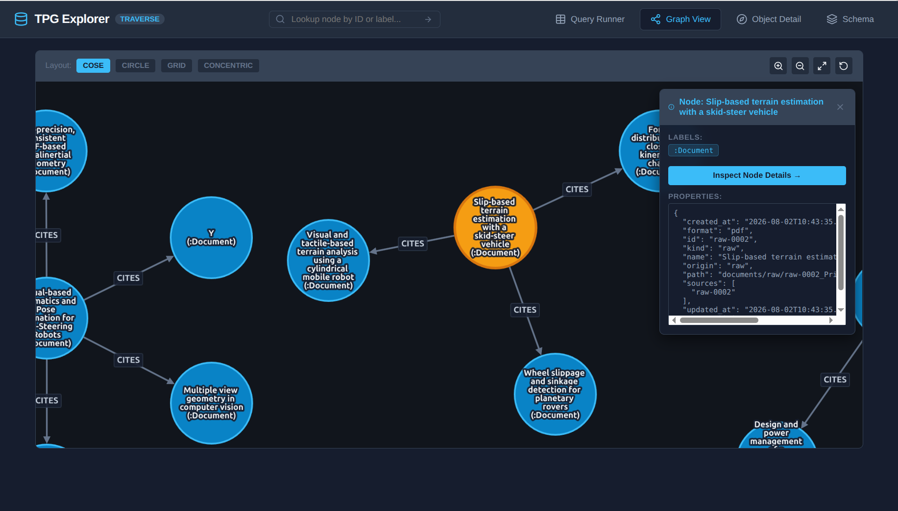
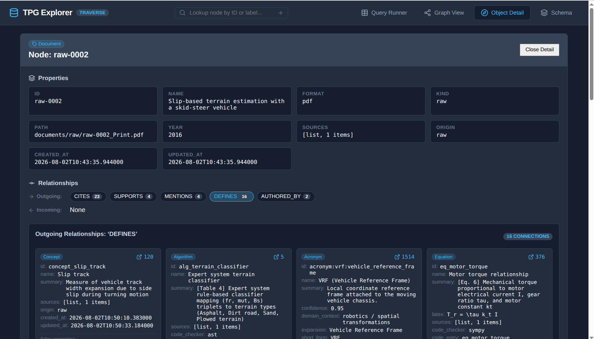
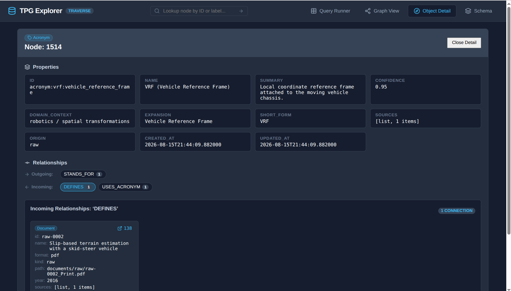

# TPG Explorer

TPG Explorer is a modern, responsive web explorer for Property Graph databases, with native support for the **Truespar Traverse** GQL/Cypher HTTP API.

Inspired by TypeDB Studio and Neo4j Browser, TPG Explorer combines:
- An interactive **Query Runner** supporting both GQL and Cypher.
- An interactive **Cytoscape.js Graph View** with automatic element extraction, layout algorithms, zooming, and pan controls.
- A TypeDB Studio-style **Object Detail View** with incoming/outgoing relationship summary badges, live counts, and connected node expansion.
- A **Schema Visualizer** mapping node labels, relationship types, cataloged properties, and connection patterns (when provided by the server).
- Fast, non-interactive local development and automated CI testing using `uv` and `npm`.

---

## Architecture Overview

```
.
├── LICENSE                    # MIT License
├── .github/
│   └── workflows/
│       └── ci.yml             # GitHub Actions CI for backend & frontend
├── backend/
│   ├── pyproject.toml         # Python dependencies managed with uv
│   ├── uv.lock
│   ├── src/
│   │   └── tpg_explorer/      # FastAPI application, connection layers, schema, and query services
│   └── tests/
│       ├── fixtures/          # Canned Traverse HTTP mock responses
│       ├── conftest.py
│       └── test_*.py
├── frontend/
│   ├── package.json
│   ├── vite.config.ts
│   ├── tsconfig.json
│   ├── src/                   # React 19 components, Cytoscape graph, detail views
│   └── tests/                 # Vitest unit tests & visual screenshot harness
└── specification.md
```

---

## Quickstart

### Interactive Launch (One-Command)
To launch the complete environment (Traverse graph database server, FastAPI backend, and Vite frontend) against any `.tvdb` file:

```bash
./launch_explorer.sh /path/to/database.tvdb
```

Or try it immediately with a self-contained **demo graph** (auto-created and seeded at `.demo/demo.tvdb`):

```bash
./launch_explorer.sh --demo
```

If you already have a running Traverse server instance, launch only the backend and frontend:

```bash
TRAVERSE_URL=http://localhost:7691 API_KEY=your_api_key ./launch_explorer.sh --external-db
```

When ready, open [http://localhost:5173](http://localhost:5173). Press `Ctrl+C` in the terminal to gracefully stop all services.

You can override binary paths, ports, or database settings with CLI flags (`./launch_explorer.sh --help`) or environment variables:
```bash
TRAVERSE_BIN=/path/to/traverse-server HTTP_PORT=7691 BACKEND_PORT=8000 FRONTEND_PORT=5173 ./launch_explorer.sh /path/to/database.tvdb
```

---

### Manual Step-by-Step Setup

### Prerequisites
- **Python**: 3.11+ and [uv](https://github.com/astral-sh/uv)
- **Node.js**: 20+ and npm

### Backend Setup
```bash
cd backend
uv sync
uv run pytest -v
uv run uvicorn tpg_explorer.main:app --reload --port 8000
```

Backend environment variables:
- `TPG_TRAVERSE_URL`: URL of the Traverse HTTP endpoint (default: `http://localhost:7691`)
- `TPG_DEFAULT_DATABASE`: Target database name (default: `default` or `traverse`)
- `TPG_TRAVERSE_API_KEY`: API key for Traverse HTTP API (e.g. `tvs_...`)

### Frontend Setup
```bash
cd frontend
npm ci
npm run lint
npm run typecheck
npm run test:run
npm run dev
```

The frontend Vite development server runs on `http://localhost:5173` with proxy configuration forwarding `/api` calls to the backend on `http://localhost:8000`.

---

## Features

### 1. Query Runner
- Switch between **GQL** and **Cypher** dialects.
- Format and tabularize complex results including nested maps, lists, and primitives.

### 2. Interactive Cytoscape Graph View
- Automatically parses graph nodes and edges from query rows.
- Dynamic layout selection: `cose`, `breadthfirst`, `circle`, `concentric`, and `grid`.
- Direct canvas interactions: node selection panel, zooming, panning, and fit to viewport.



### 3. Object Detail View & Search
- TypeDB Studio-inspired navigation.
- Node ID, label pills, and formatted property inspector.
- Outgoing and incoming relationship badges with live counts.
- Expanding relationship types dynamically fetches connected nodes with summary properties.
- Header search bar for direct node lookup.



### 4. Schema Visualizer
- Node labels and relationship types catalog.
- Property key types.
- Observed connection patterns between graph node labels (if reported by the server).



---

## Testing & Quality Assurance

- **Backend tests**:
  ```bash
  uv run pytest -v
  uv run ruff check .
  ```
- **Frontend tests**:
  ```bash
  npm --prefix frontend run lint
  npm --prefix frontend run typecheck
  npm --prefix frontend run test:run
  npm --prefix frontend run build
  ```

---

## License

This project is licensed under the MIT License. See [LICENSE](LICENSE) for details.
